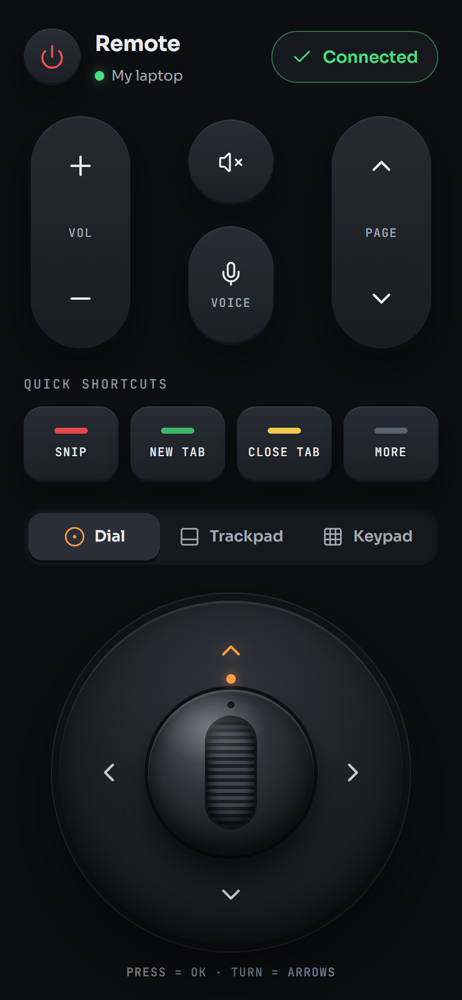
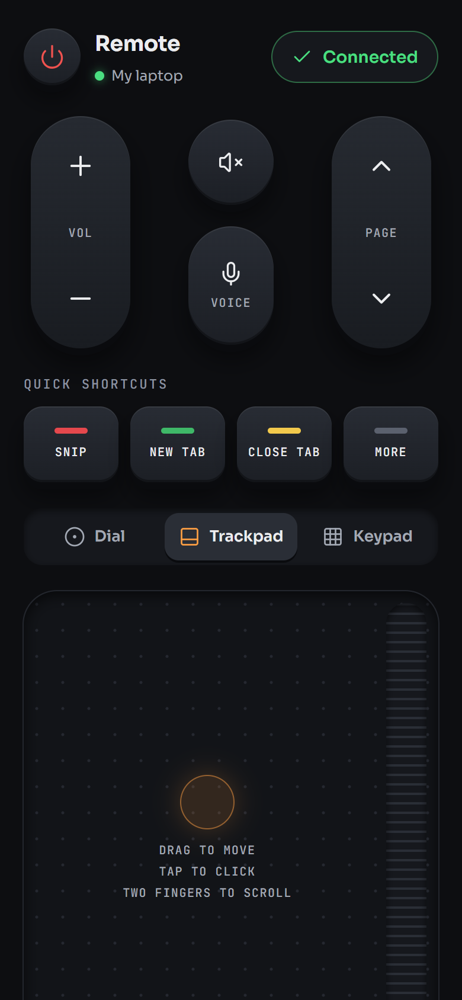
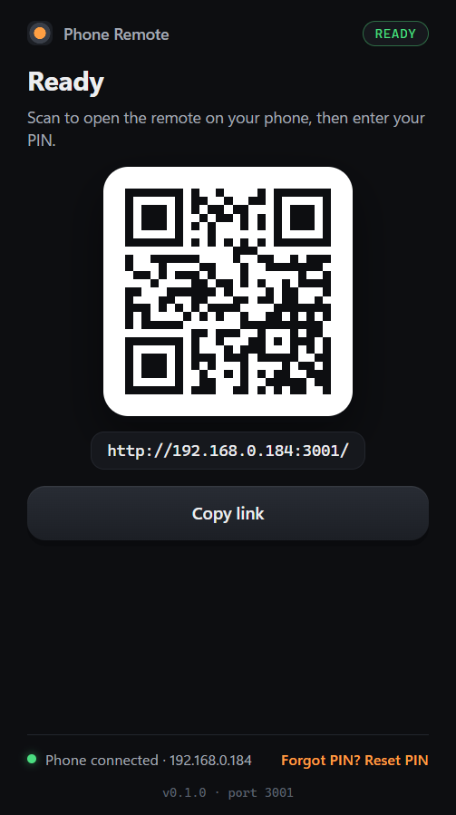

<p align="center">
  
</p>

<h1 align="center">Phone Remote</h1>

<p align="center">
  Turn your phone into a remote control and trackpad for your Windows laptop.<br />
  No account, no cloud. It works over your own Wi-Fi.
</p>

<p align="center">
  <a href="https://github.com/JoshuaOzibo/Remote-control-app/releases/latest/download/PhoneRemote-Setup.exe">
    
  </a>
</p>

<p align="center">
  <a href="https://github.com/JoshuaOzibo/Remote-control-app/releases/latest"></a>
  <a href="https://github.com/JoshuaOzibo/Remote-control-app/releases"></a>
  
  
</p>

<p align="center">
  <a href="https://github.com/JoshuaOzibo/Remote-control-app/releases/latest/download/PhoneRemote-Setup.exe"><b>Download the latest version</b></a>
  ·
  <a href="https://github.com/JoshuaOzibo/Remote-control-app/releases">All releases</a>
  ·
  <a href="#getting-started">Getting started</a>
</p>

<br />

<table align="center">
  <tr>
    <td align="center"></td>
    <td align="center"></td>
    <td align="center"></td>
  </tr>
  <tr>
    <td align="center"><sub>Dial: arrows, OK, volume, shortcuts</sub></td>
    <td align="center"><sub>Trackpad: move, tap, two-finger scroll</sub></td>
    <td align="center"><sub>On the laptop: scan the QR code to connect</sub></td>
  </tr>
</table>

## Why

My laptop is plugged into a big monitor across the room. Skipping a YouTube ad, pausing a video or opening a new tab meant walking over to the keyboard. Phone Remote puts all of that on the phone that is already in your hand.

## Features

- **Trackpad.** Drag to move the cursor, tap to click, two-finger tap to right-click, two fingers to scroll.
- **Navigation dial.** Arrow keys and OK on a 3D dial, with hold-to-repeat. Great for menus and video players.
- **Media and volume.** Volume, mute, play/pause, next and previous, full screen, and voice typing (Win + H).
- **Type from your phone.** Send text to the laptop, including emoji and accents.
- **Shortcuts.** Snip, new or close tab, switch windows, lock, task manager, snap left or right, copy and paste, and more.
- **Setup by QR code.** Scan the QR code the laptop shows, choose a PIN, and you're in. The phone reconnects by itself next time.
- **Add to Home Screen.** It opens like an app on your phone.
- **Tray app.** It sits quietly in the Windows tray. It can start with Windows and tells you when an update is out.

## Getting started

1. **Download** [`PhoneRemote-Setup.exe`](https://github.com/JoshuaOzibo/Remote-control-app/releases/latest/download/PhoneRemote-Setup.exe) and run it.
   - Windows may say **"Windows protected your PC"**, because the app isn't code-signed yet. Click **More info** → **Run anyway**.
   - The installer asks for admin rights once, so it can add a firewall rule for your private network.
2. **Phone Remote opens** and shows a QR code. Your phone must be on **the same Wi-Fi** as the laptop.
3. **Scan the QR code** with your phone's camera and **choose a 4-digit PIN**. That's it: the remote is connected.
4. *(Optional)* On your phone, use **Add to Home Screen** so the remote opens like an app.

Next time, just open the remote on your phone. It connects by itself while Phone Remote is running in the laptop's tray (right-click the tray icon to turn on **Start with Windows**).

> **Is your Wi-Fi set to "Public"?** Windows blocks other devices on Public networks, and the app shows a warning when that's the case. Go to **Settings → Network & internet → Wi-Fi → your network** and set **Network profile type** to **Private**.

## How it works

```
 Phone browser  ── Wi-Fi (WebSocket) ──►  Phone Remote on the laptop  ──►  Windows mouse and keyboard
 (the remote page)                        (tray app + small local server)
```

The laptop app runs a small web server on your network. Your phone opens the remote page from the laptop itself, then sends tiny messages like *"move 3px right"* or *"press volume up"*, and the laptop performs them.

## Privacy and security

- **Nothing leaves your network.** No cloud, no account, no tracking. The phone talks straight to the laptop.
- **You choose the PIN**, and the laptop stores only a scrambled hash of it, never the PIN itself.
- **Only someone at the laptop can set or reset the PIN.** It needs the one-time code shown on the laptop's screen.
- **Guessing is stopped.** After 5 wrong PINs, that device is locked out for a minute.
- **One phone is in control at a time.** Other websites in your browser can't connect to it.
- The firewall rule only allows **Private** networks (plus the laptop's own hotspot).

## FAQ

<details>
<summary><b>My phone can't connect</b></summary>

- Make sure the phone and the laptop are on the **same Wi-Fi** (not a guest network, and not mobile data).
- Set the laptop's Wi-Fi to **Private** (see above).
- Check that Phone Remote is running (the icon in the taskbar tray).
- Some hotel and office networks block devices from talking to each other. Turn on the laptop's **Mobile hotspot** and connect the phone to it instead.
</details>

<details>
<summary><b>I forgot my PIN</b></summary>

On the laptop, right-click the Phone Remote tray icon → **Reset PIN**. A new QR code appears. Scan it and choose a new PIN.
</details>

<details>
<summary><b>The remote on my home screen stopped working</b></summary>

The laptop's address on your Wi-Fi probably changed. Open Phone Remote on the laptop and scan the new QR code. To stop this from happening, give the laptop a fixed address in your router's settings (often called *DHCP reservation*).
</details>

<details>
<summary><b>How do I update?</b></summary>

When a new version is out, the tray menu shows **Update available**. Click it, download the new installer and run it. Your PIN and settings are kept.
</details>

<details>
<summary><b>Does it work on Mac or Linux?</b></summary>

Not yet. The laptop app is Windows only (10 and 11, 64-bit). The phone side works in any modern phone browser (iPhone or Android).
</details>

## For developers

The repo has three parts:

| Folder | What it is | Stack |
|---|---|---|
| [`frontend/`](frontend) | The phone remote (static web app) | Next.js 16, React 19, TypeScript, Tailwind CSS 4, Zustand |
| [`backend/`](backend) | The laptop server: serves the page and turns messages into real input | Node.js, Express 5, `ws`, nut-js |
| [`desktop/`](desktop) | The Windows tray app and installer that run the backend | Electron 44, electron-builder (NSIS) |

**Run it from source** (Windows, Node.js 22+):

```powershell
cd frontend; npm install
cd ..\backend; npm install; npm run build:web   # builds the phone page into backend/public
cd ..\desktop; npm install; npm run dev         # tray app with the QR window
```

To run only the server in a terminal, run `npm start` in `backend/`. It prints the address and a setup link.

**Build the installer:** `cd desktop` → `npm run dist` → `desktop\dist\PhoneRemote-Setup.exe`.

**Release a new version:** bump `version` in `desktop/package.json`, then `npm run dist`. Create a GitHub release tagged `vX.Y.Z` and attach `PhoneRemote-Setup.exe`, keeping that exact file name. The download button above and the in-app update check pick it up automatically.

<p align="center"><sub>Made by <a href="https://github.com/JoshuaOzibo">Joshua Ozibo</a></sub></p>
